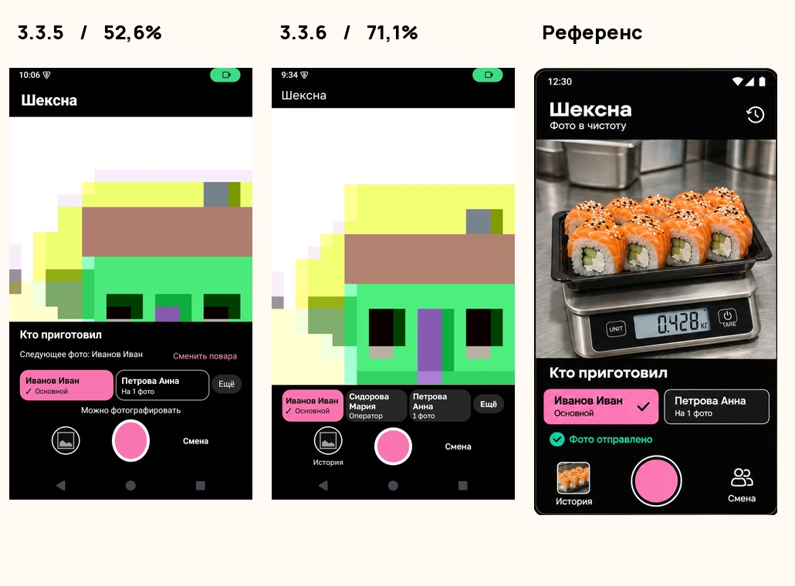

# Фото в чистоту 3.3.6: согласование интерфейса

[Начать с выбора города](https://miro.com/app/board/uXjVEMrZVUo=/?moveToWidget=3458764690826872748) · [Открыть камеру с оператором](https://miro.com/app/board/uXjVEMrZVUo=/?moveToWidget=3458764690826872754) · [PR #4](https://github.com/fan19zenit-sketch/android/pull/4). В филиалах ничего не устанавливали.

## Что смотреть

- [Все 35 портретных скриншотов](screens/) сняты с cleanPreview на Android 15 из исходников кандидата. Имена синтетические; вместо настоящей кухни у эмулятора тестовая камера. Это не нарисованный интерфейс и не подтверждение отправки в рабочий MAX.
- [Основная камера](screens/11-camera.png) → [выбран оператор](screens/12a-operator.png): розовая карточка действует на один успешно сохранённый снимок. Участники с ролью оператора не спрятаны за «Ещё», если backend для привязки поддерживает авторство оператора. Роль в составе смены и получатель карточек нарушений не меняются. Универсал с двумя ролями показан один раз.
- [Постоянный выбор](screens/11c-change.png) находится в «Смена» → «Сменить основного повара»; не меняет ранее снятые фото или второй телефон. [На пицца-телефоне](screens/12b-pizza-camera.png) выбранный сотрудник остаётся активным до следующего переключения.
- [История](screens/14-history.png), [повтор](screens/15b-retry.png), [служебное меню](screens/16b-menu.png), [просмотр снимка](screens/17-viewer.png). Доставка подтверждается как и раньше, не по локальному сохранению.
- Шапка 44 dp. При 1080×1920 / 420 dpi: до редизайна видимая область камеры составляла 52,6% полезной высоты, теперь с двумя поварами и оператором 71,1%; нижняя панель 146,3 dp. Затвор 64×64 dp. При [130% и длинной фамилии](11-large-text.png) панель растёт до 182,9 dp; подпись проверена на обрезание. [Альбомная камера](11-land.png) и [альбомная история](14-land.png) проверены при 1280×720 / 320 dpi.
- Для Oddval и Helvetica не найдены исходники с подтверждённым правом встраивания в APK. В приложении локальные Manrope (заголовки) и Golos Text (текст и подписи), не оригинальные шрифты брендбука. Кириллица, включая «Ё», проверена. Обе лицензии SIL OFL включены в APK, сетевых шрифтов нет.

## Карта для сотрудника

Слева на каждой странице настоящие экраны; справа розовая карточка с действием, стрелка и кликабельный результат. В режиме редактирования Miro для перехода нажмите на подчёркнутый результат, затем на появившуюся ссылку.

- [01   Введите город](https://miro.com/app/board/uXjVEMrZVUo=/?moveToWidget=3458764690826872748)
- [02А   Основной телефон](https://miro.com/app/board/uXjVEMrZVUo=/?moveToWidget=3458764690826872749)
- [03А   Один сотрудник](https://miro.com/app/board/uXjVEMrZVUo=/?moveToWidget=3458764690826872750)
- [03Б   Несколько сотрудников](https://miro.com/app/board/uXjVEMrZVUo=/?moveToWidget=3458764690826872751)
- [02Б   Телефон пицца-цеха](https://miro.com/app/board/uXjVEMrZVUo=/?moveToWidget=3458764690826872752)
- [03В   Камера пицца-цеха](https://miro.com/app/board/uXjVEMrZVUo=/?moveToWidget=3458764690826872753)
- [04   Камера: кто приготовил?](https://miro.com/app/board/uXjVEMrZVUo=/?moveToWidget=3458764690826872754)
- [05   История: куда ушло фото?](https://miro.com/app/board/uXjVEMrZVUo=/?moveToWidget=3458764690826872755)

[Скриншот первого шага на доске](miro-start.png). Проверены 20 стрелок и 20 ссылок на результат в восьми основных фреймах. Из стартового фрейма фактически выполнен переход в пицца-цех. Архив предыдущей презентации не удалён. MAX показан по ранее подтверждённым материалам; выбор продукта и причины в рабочем MAX на этой сборке не перепроверяли. [Исходные действия карты](walkthrough.json).

## Установочный кандидат

- `photo-v-chistotu-3.3.6-2471f4b.apk`, версия 3.3.6 / 20261119, приложение `com.example.photovchistotu`.
- Код выпуска `2471f4bc4b931b1988e54ebdd75dfb49e7314a78`, SHA-256 файла `b09bf26ffc10760220392c934c22d6fedac89ab2651dd531109e7f267a0d475a`.
- Сертификат SHA-256 `7d0884e53e704a683a162ca2f34c7db1e1006c07c20147d61f1892d4b3dcfca4`. Проверены v2/v3, zipalign и 16 КБ для четырёх библиотек. Все 940 исходных ZIP-записей совпадают с release-APK до подписи.
- Точное обновление поверх подписанной 3.3.5 без удаления приложения между версиями: филиал, UUID, настройки, история, идентификаторы очереди и четыре файла сохранены. Три старых снимка дошли на изолированный сервер по разу, без назначения сегодняшнего автора.
- [CI для точного коммита](https://github.com/fan19zenit-sketch/android/actions/runs/44277684652): build и оба устройства, Android 14 и 15 (16 КБ), успешно. На локальной сборке: 43 JVM-теста без ошибок, lint 0 ошибок / 115 предупреждений, собран legacyDebug.
- Локально: 78/78 инструментальных тестов preview, отдельно 1/1 порядок разрешений. До изоляции тестовых UUID два ожидания экрана периодически истекали. Финальный прогон использует отдельный тестовый телефон на сценарий и ждёт видимой смены состояния перед нажатием; ни один тест не отключён. Эти правки касаются только тестов и не меняют подписанный APK.

На настоящем телефоне после согласования дизайна: проверить читаемость делений весов в реальном предпросмотре, поворот готового файла, Bluetooth-затвор, несколько офлайн-снимков подряд и возврат после блокировки экрана. Производственный backend и маршруты рассылок для этого выпуска не изменялись.
